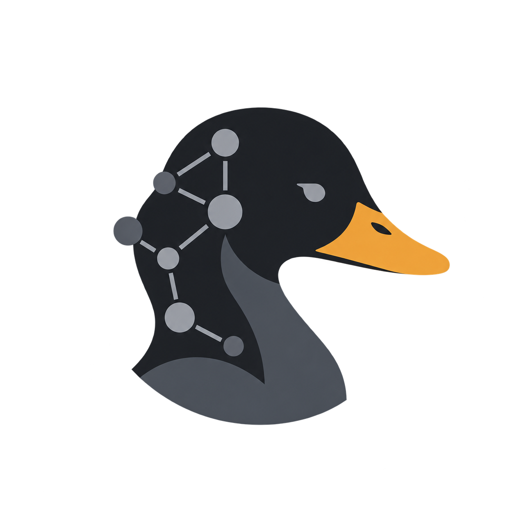

  

# Duckscale

A Linux desktop app for reliable Tailscale connection control and account switching.

## Initial scope

- Enable or disable Tailscale, with status confirmed by the daemon.
- List saved accounts and switch the active Tailscale profile.
- Add accounts through Tailscale browser authentication.
- Show actionable errors and recover after daemon restarts.

## Approach

Use the official tailscaled service for networking and authentication, communicating through its local API. Initial target: Linux Mint Cinnamon.

## Status

Planning stage. Implementation has not started. Toolkit and packaging choices remain open.

Duckscale is an independent project, not affiliated with or endorsed by Tailscale.
